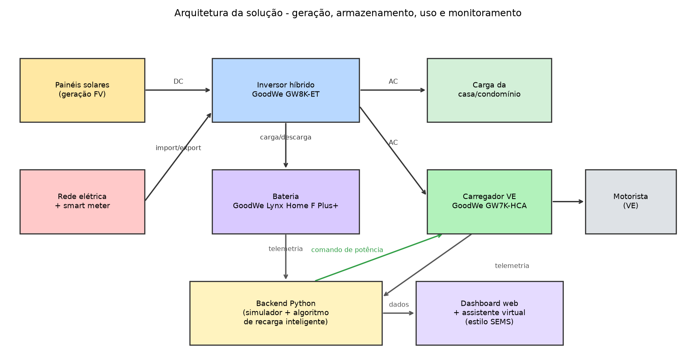
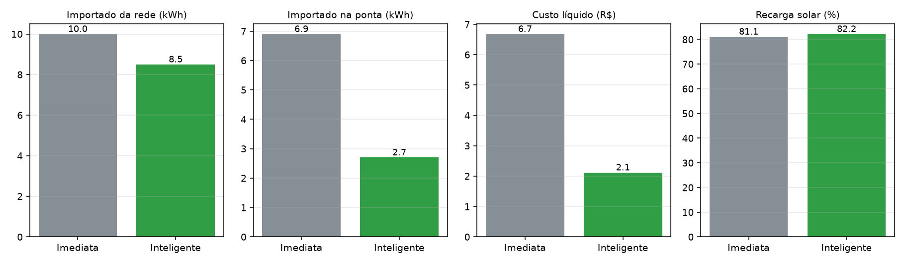
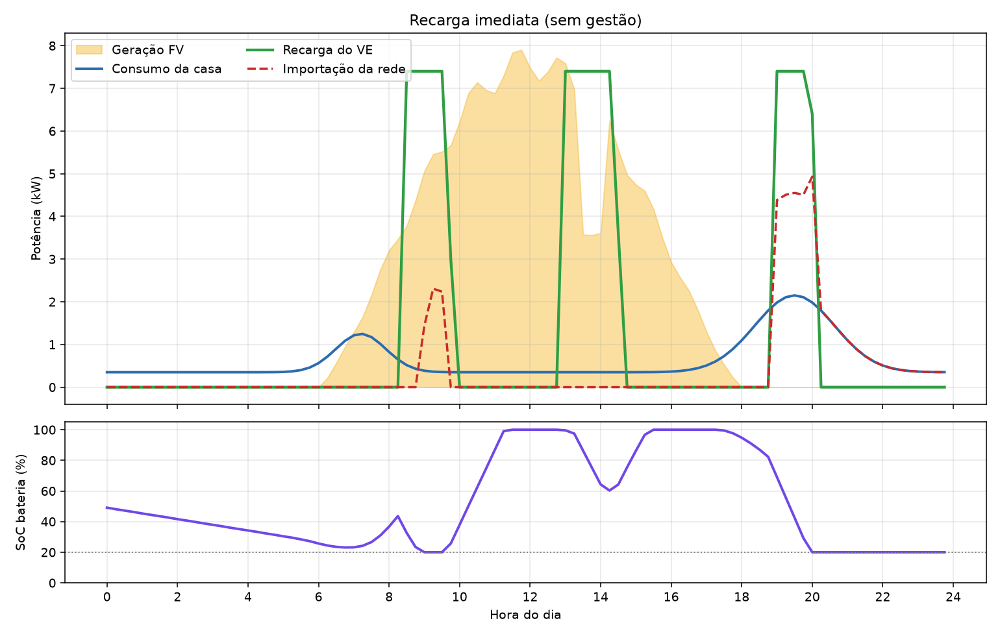
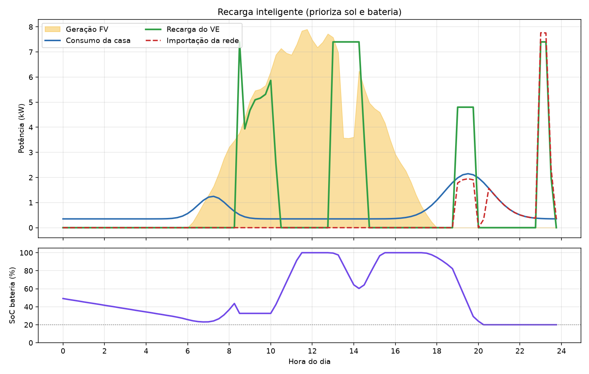

# Estação de Recarga Solar Inteligente (referência GoodWe)

**Sprint 4 – Solução Final Integrada e Inovadora Goodwe**

## Equipe

| Nome | RM |
|------|----|
| Guilherme Xavier | 573053 |
| Beckman Lugli | 573442 |
| Bryan Lugli | 571350 |

Vídeo técnico (YouTube, não listado): _colar o link aqui_

---

## 1. O desafio e a nossa proposta

O desafio é integrar **geração solar, armazenamento e uso da energia** com **monitoramento inteligente**, usando tecnologias compatíveis com a GoodWe. Nossa proposta é uma **estação de recarga de veículos elétricos (VE) alimentada por energia solar**, com um algoritmo que decide *quando* e *com que potência* cada carro recarrega, para aproveitar ao máximo o sol e a bateria e reduzir o uso da rede, principalmente no horário de ponta.

Em vez de apenas "ligar o carro na tomada", o sistema trata a recarga como uma **carga flexível**: ela pode ser adiada para o horário de sol, desde que o veículo esteja pronto no prazo combinado.

## 2. Arquitetura final e integração



| Bloco | Função no sistema | Equipamento de referência |
|-------|-------------------|---------------------------|
| Painéis solares | Geração FV (campo simulado de 8 kWp) | – |
| Inversor híbrido | Converte DC→AC e gerencia bateria, casa e rede | GoodWe **GW8K-ET** (híbrido trifásico, 8 kW) |
| Bateria | Guarda o excedente solar para a noite (≈9,8 kWh úteis, reserva de 20 %) | GoodWe **Lynx Home F Plus+** |
| Carregador de VE | Entrega a energia ao carro (7,4 kW por ponto de recarga) | GoodWe **GW7K-HCA** |
| Medidor de energia | Mede importação/exportação da rede | Medidor GoodWe (acompanha a linha ET Plus+) |
| Backend Python | Simula o sistema, executa o algoritmo de recarga e gera os dados | – |
| Dashboard web e assistente | Visualização dos fluxos e perguntas em linguagem natural | Inspirado no portal **SEMS** |

**Fluxo de dados:** a cada passo de 15 minutos o backend calcula geração solar e consumo da casa, decide a potência de cada sessão de recarga, faz o balanço de energia (despacho do inversor/bateria/rede) e registra tudo em CSV e JSON. Esses dados alimentam os gráficos, o dashboard e o assistente.

> **Transparência:** o sistema é um **protótipo simulado**. Os equipamentos GoodWe são representados por modelos de comportamento com parâmetros de referência. A potência máxima de carga/descarga da bateria (5 kW) é uma **premissa nossa**, a conferir no datasheet do sistema. Em uma instalação real, a telemetria viria do inversor e do carregador, que se integram ao portal/app SEMS, no lugar das funções de simulação.

## 3. Como o algoritmo funciona (diferencial inovador)

Cada sessão de recarga é um objeto `Sessao` (chegada, saída e energia necessária). A cada passo:

1. **Prazo manda:** se só dá tempo de terminar carregando na potência máxima, o sistema força a recarga (usando a rede se preciso). Assim, **nenhum motorista fica sem carga**.
2. **Sol primeiro:** fora do prazo crítico, o carro recebe apenas o **excedente solar** (geração – consumo da casa).
3. **Bateria como apoio:** se a bateria está acima de 35 % de carga, ela também pode alimentar o carro, preservando reserva para a casa.
4. **Rede por último:** a rede só entra quando sol e bateria não bastam e o prazo exige.

A estratégia é comparada com a **recarga imediata** (carro carrega na potência máxima assim que chega), que representa uma estação sem gestão.

## 4. Resultados obtidos

Cenário simulado (1 dia): geração solar de **51,1 kWh**, consumo da casa de **15,1 kWh** e **3 sessões de recarga** totalizando **31 kWh** (10, 12 e 9 kWh), todas concluídas nas duas estratégias.

| Métrica | Imediata | Inteligente | Variação |
|---------|---------:|------------:|---------:|
| Energia importada da rede (kWh) | 10,0 | 8,5 | −15,0 % |
| Importação no horário de ponta, 18h–21h (kWh) | 6,9 | 2,7 | **−60,9 %** |
| Autoconsumo da geração solar (%) | 67,3 | 70,0 | +2,7 p.p. |
| Autossuficiência (%) | 78,3 | 81,5 | +3,2 p.p. |
| Parcela solar da recarga (%) | 81,1 | 82,2 | +1,1 p.p. |
| Custo líquido do dia (R$) | 6,68 | 2,12 | **−68,3 %** |
| Sessões concluídas | 3/3 | 3/3 | – |



Fluxos de potência ao longo do dia (a recarga inteligente se concentra nas janelas de sol e a bateria sustenta o início da noite):

| Imediata | Inteligente |
|---|---|
|  |  |

**Leitura qualitativa**
- O maior ganho está no **custo e no pico**: o algoritmo tira a recarga do horário de ponta, quando a energia é mais cara e a rede mais pressionada.
- O ganho em **autoconsumo** é moderado: neste cenário já havia bastante sol e o Carro A chega cedo. O diferencial seria maior com mais veículos ou menos sol.
- A recarga noturna do Carro C depende da bateria e, no fim, de um pouco de rede, porque a bateria chega à reserva de 20 %.

**Validação:** `python testes.py` verifica que todas as sessões são concluídas, que o SoC fica entre 20 % e 100 %, que o carregador não passa de 7,4 kW e que o balanço de potência fecha em cada passo.

## 5. Impacto: sustentabilidade, eficiência e viabilidade

- **Pegada de carbono:** os 31 kWh de recarga equivalem a cerca de **186 km** rodados. Frente a um carro a combustão (12 km/L), isso evitaria aproximadamente **33,8 kg de CO₂ no dia**, já descontando as emissões da rede (≈0,33 kg). A rede brasileira é relativamente limpa (38,5 kg CO₂/MWh em 2023, segundo o MCTI), então o ganho principal vem de **substituir o combustível**; a gestão inteligente reduz ainda mais a parcela vinda da rede. O valor de 2,2 kg CO₂/litro é uma simplificação para gasolina pura; como a gasolina comum leva etanol, o ganho real tende a ser menor.
- **Eficiência:** mais autossuficiência (81,5 %) e menos energia importada reduzem a dependência da rede.
- **Viabilidade técnica:** o algoritmo usa apenas dados que um inversor híbrido e um carregador conectados já fornecem (potência FV, SoC, potência de carga). A linha HCA da GoodWe oferece carregamento com excedente solar e gerenciamento pelo SEMS, o que torna a solução compatível com uma implantação real.
- **Relevância social:** viabiliza recarga de VE de baixo custo em condomínios e pequenos comércios e alivia a rede no horário de ponta.
- **Premissas ilustrativas** (editáveis em `CONFIG`): tarifas (R$ 0,85 fora de ponta, R$ 1,80 na ponta), crédito de injeção (R$ 0,50/kWh), 6 km/kWh do VE e 12 km/L do carro a combustão.

## 6. Alinhamento com o desafio GoodWe e com a disciplina

| Ponto do desafio | Como a solução atende |
|------------------|-----------------------|
| Geração, armazenamento e uso de energia renovável | Fluxo completo FV → bateria → casa/VE, com balanço a cada 15 min |
| Tecnologias compatíveis GoodWe | Arquitetura com inversor híbrido GW8K-ET, bateria Lynx Home F Plus+, carregador GW7K-HCA e monitoramento no estilo SEMS |
| Monitoramento inteligente | Séries temporais em CSV/JSON, gráficos e **dashboard web interativo** (`dashboard.html`) |
| Algoritmos inteligentes e automação | Priorização solar com prazo de segurança e comando automático de potência |
| Interface amigável e assistente virtual | Dashboard com abas, KPIs e cursor de horário; assistente por regras que entende perguntas em português |
| Conteúdos da disciplina | Estruturas de dados (classe `Sessao`, lista de sessões, séries temporais), algoritmos de decisão, testes, análise de resultados e modularização em Python |

O assistente atual é **baseado em regras** (reconhece radicais como "econom", "co2", "bateria"). Como evolução, ele pode ser conectado a um modelo de linguagem ou a assistentes de voz.

## 7. Tecnologias e referências

- **Python 3** (dataclasses, `csv`, `json`, `math`, `re`) e **Matplotlib** (gráficos e diagrama); **HTML/CSS/JavaScript** puro no dashboard.
- GoodWe: [linha de carregadores HCA](https://en.goodwe.com/goodwe-launches-solar-powered-smart-ev-charger-for-residential-use) (7 kW monofásico e 11/22 kW trifásico, gestão via SEMS), inversores híbridos da série ET e baterias Lynx Home F. Site oficial: https://www.goodwe.com
- Fator de emissão da rede: MCTI, média do SIN em 2023 de 38,5 kg CO₂/MWh. Em 2025 os fatores mensais publicados ficaram entre 21,5 e 28,9 kg/MWh (jan–abr); usamos o valor de 2023, mais conservador.

## 8. Como executar

```bash
pip install -r requirements.txt
python simulador_goodwe.py              # gera resultados/, docs/ e dashboard.html
python simulador_goodwe.py --assistente # assistente virtual no terminal
python testes.py                        # testes de sanidade
```

Abra o `dashboard.html` no navegador (duplo clique). Exemplos de perguntas ao assistente: *"quanto gerei hoje?"*, *"quanto economizei?"*, *"quanto CO2 evitei?"*, *"como está a bateria?"*.

## 9. Estrutura do repositório

```
├── simulador_goodwe.py        # simulação, algoritmo, gráficos e assistente
├── dashboard.py               # gerador do dashboard web
├── dashboard.html             # dashboard interativo (abrir no navegador)
├── testes.py                  # testes de sanidade
├── requirements.txt
├── README.md
├── docs/
│   ├── arquitetura.png
│   ├── comparacao_estrategias.png
│   ├── fluxos_recarga_imediata.png
│   ├── fluxos_recarga_inteligente.png
│   └── roteiro_video.md
└── resultados/
    ├── resultados.json
    ├── serie_imediata.csv
    └── serie_inteligente.csv
```

## 10. Limitações e próximos passos

- Dados simulados: o próximo passo é ler a telemetria real do inversor e do carregador.
- Previsão de geração (meteorologia) para decidir o adiamento da recarga com mais antecedência.
- Várias sessões simultâneas dividindo a potência do carregador.
- Assistente com linguagem natural (LLM) e voz.
